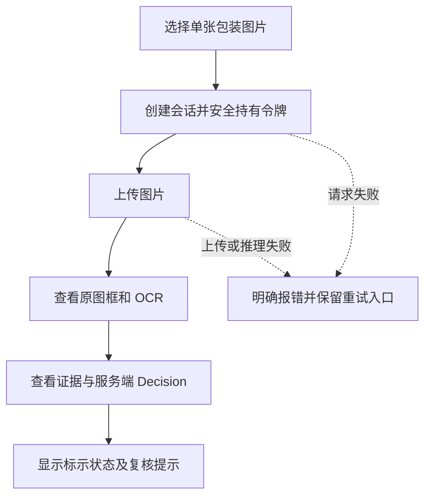

# WebClient · 轻眸识刻 Web 客户端

> M0 单图闭环优先入口；当前为需求与交互设计，M0 待实现。

WebClient 面向消费者、商超和仓储人员，规划通过 `InferPlatform` 的统一 API 完成在线查验，不直接访问数据库、模型文件或 TrainPlatform。本仓设计不能证明客户端已运行，也不能证明代码、测试、部署或模型已经交付。

系统展示的是食品包装的**标示状态**，不是食品安全结论，不保证食品可食用。性能与识别效果必须由实际评测证明。

## 一、范围与需求映射

- **M0 待实现**：创建会话 -> 上传单张图片 -> 查看原图检测框、OCR、证据与 Decision。先验证这条最小链路，手工文本或框修正不是 M0 前置条件。
- **C0 后续规划**：FR-C0-005 的同一食品多图追加、时间线与完整结果展示；FR-C0-006 的契约内补录、人工纠偏和审核回流。M0 只是 C0 交互的一部分，不等同于完整验收。
- **消费输出而非实现算法**：消费 FR-C0-002 检测、FR-C0-003 OCR 和 FR-C0-004 日期决策输出；不在浏览器实现这些算法或业务规则。
- **数据准入边界**：FR-C0-001 是训练与评测样本采集、质量审核职责，不是普通用户上传图片即可完成的工作。
- **可选候选**：摄像头、拖拽、剪贴板导入与局部图像对照按后续交互验证接入；条码辅助映射 FR-C1-001，仅作弱辅助证据，不覆盖包装文字。

项目保持 **8 仓：7 个项目仓 + `.github` 组织配置仓**，不新增、合并或重命名仓库。Inference Runtime 是 InferPlatform 内部逻辑模块，不是第 9 仓。MobileClient、WxClient 为后续规划、工程暂缓，不是已经运行的扩展端；跨端接续会话的授权与任务契约尚未实现，不承诺无缝继续处理。

## 二、M0 路径与界面模块



| 模块 | M0 展示目标 | C0 后续扩展 |
| :--- | :--- | :--- |
| 会话与上传 | 单图选择、上传反馈、会话查询 | 多图追加、图片切换与时间线 |
| 原图画布 | 按契约坐标呈现框、类别及置信度，缩放时保持框图一致 | 局部放大与图像对照 |
| OCR 与证据 | 显示服务端 OCR、证据来源和缺失提示 | 完整证据关联、机器值与修正值对照 |
| Decision 卡片 | 展示服务端日期、标示状态和复核状态 | 契约内补录、纠偏及更新反馈 |

原始裁剪、几何校正、局部增强和 OCR 输入图等 `variants` 是后续可选视图；当前 API 不因此被假定已有图片地址或 variants 字段，需先定义资产访问契约再接入。摘要视图可以简化界面，但服务端摘要响应需要未来单独契约，不能替代完整结果 DTO。

## 三、结果边界与统一状态

- **Observation**：机器观察值来自 Inference Runtime，经 InferPlatform 返回；客户端只展示，不提交或改写机器 Observation。
- **Evidence**：由 InferPlatform 提取和聚合，界面保留来源、关联及机器值/人工修正的区别。
- **Decision**：由 InferPlatform 按版本化日期规则生成，客户端直接呈现，不自行计算临期阈值、到期日或其他业务结论，也不通过重算剩余天数改变结果。
- 平台按契约返回完整、版本化的 Observation、Evidence、Decision **安全 DTO**；客户端不依赖内部路径、存储凭证等实现细节。字段与版本以中枢契约为准。

| 状态维度 | 统一展示及枚举 |
| :--- | :--- |
| 标示状态 | 在期 `WITHIN_MARKED_PERIOD`、临期 `NEAR_EXPIRY`、超期 `PAST_MARKED_PERIOD`、无法判定 `UNDETERMINED` |
| 复核状态 | 证据完备 `EVIDENCE_COMPLETE`、信息缺失 `INFORMATION_MISSING`、证据冲突 `EVIDENCE_CONFLICT`、低置信度 `LOW_CONFIDENCE` |

两种状态独立显示，不能只依赖颜色。**推理失败不是 `UNDETERMINED`**：无法判定是有效业务结果，超时或服务失败必须明确报错，不得伪造成功结果。保存条件、开封后说明等只作条件提示，不作安全保证。

## 四、UX 状态、错误与可访问性

以下是提议的前端 UX 状态，不新增服务端状态枚举：

```text
IDLE -> CREATING_SESSION -> UPLOADING -> PROCESSING -> RESULT_READY
请求失败 -> FAILED（显示原因、重试入口和待确认操作）
C0 纠偏：RESULT_READY -> SUBMITTING_CORRECTION -> RESULT_READY / FAILED
```

复核提示依据 `review_status` 单独呈现，不等同于请求失败。网络中断、超时、格式/大小校验失败、会话或令牌失效均需说明下一步；结果是否成功同时校验 HTTP 与业务响应，失败不能显示 success。重试保留同一操作的幂等键，结果不确定时按契约重试或查询确认，不猜测完成。

- 摄像头权限被拒绝时回退文件选择；剪贴板、拖拽或条码不可用时不阻断单图主流程。
- 兼容性需实际验证桌面 Chrome/Edge 与目标移动浏览器，不承诺所有设备能力一致。
- 结果提供文字、图标、大字号和高对比度；上传、重试、补拍与纠偏控件具备明确标签、键盘可操作性与足够点击区域。
- 上传前提示用途及契约限制，不保存不必要的图片/结果；日志不记录原始图片、完整 OCR、令牌或其他敏感内容。

## 五、InferPlatform 接口与令牌

| 阶段 | 方法与路径 | 客户端用途 |
| :--- | :--- | :--- |
| M0 待实现 | `POST /api/v1/sessions` | 创建会话，返回 `session_id` 与 `session_token` |
| M0 待实现 | `POST /api/v1/sessions/{session_id}/images` | 上传单张图片，由平台调用 Runtime 并更新结果 |
| M0 待实现 | `GET /api/v1/sessions/{session_id}` | 获取完整版本化 Observation、Evidence、Decision 安全 DTO |
| C0 后续 | `POST /api/v1/sessions/{session_id}/correction` | 提交契约内人工修正 |

创建后，会话请求使用 `Authorization: Bearer <session_token>`；创建、上传、纠偏等写操作使用 `Idempotency-Key`，同一操作重试复用原键与请求，新操作使用新键。生产传输使用 HTTPS。安全持有令牌，不分享、不写日志、不放 URL；不把会话令牌作为分享凭证。令牌失效时明确提示，不绕过鉴权。

### C0 纠偏边界

当前 `correction.v1` 定义允许修正 `mfg_date`、`exp_date`、`shelf_life`（`value` + `unit`，单位为 `DAY` / `MONTH` / `YEAR`）和 `storage_condition`。请求结构、字段类型及校验以 API/DATA 契约为准，此处不另造提交格式。

FR-C0-006 中原始 OCR 文本和检测框修正仍是规划需求，**尚未在 v1 定义**，不能据此宣称接口支持文本/框编辑。合法纠偏被服务端接受后立即更新当前 Decision，界面以返回或重新查询的最新结果为准，失败时保留输入但不显示已保存。纠偏进入训练候选另需 TrainPlatform 质量审核，不是自动训练标签，也不直接更新线上模型。

## 六、提议工程结构与技术候选

以下逐行注释的目录仅为实现建议，不代表文件或模块已存在：

```text
WebClient/                         # Web 客户端仓库
├── README.md                      # 定位、阶段与契约入口
├── package.json                   # 候选依赖与工程命令
├── vite.config.ts                 # 候选构建与开发代理配置
├── tsconfig.json                  # TypeScript 配置
├── index.html                     # 页面入口模板
└── src/                           # 客户端源码
    ├── api/                       # InferPlatform 请求、鉴权、幂等与错误处理
    ├── components/                # 原图画布、OCR 列表与二维状态卡片
    ├── features/                  # M0 会话上传结果；C0 多图与纠偏
    ├── services/                  # 后续摄像头、剪贴板与条码适配
    ├── stores/                    # 会话与 UX 状态，受控令牌生命周期
    ├── types/                     # 契约版本与安全 DTO 类型
    └── assets/                    # 静态界面资源，不存用户图片
```

候选为 React 或 Vue 3 + TypeScript + Vite；Next.js/Nuxt 按部署需要评估。选型尚未定案，不扩展服务端业务职责。

## 七、事实源与相关文档

统一以 [ProjectPRD README](https://github.com/QingMouFoodDate/ProjectPRD/blob/main/README.md)、[REQUIREMENTS](https://github.com/QingMouFoodDate/ProjectPRD/blob/main/REQUIREMENTS.md)、[ARCHITECTURE](https://github.com/QingMouFoodDate/ProjectPRD/blob/main/ARCHITECTURE.md) 为产品与职责依据；以 [API](https://github.com/QingMouFoodDate/ProjectPRD/blob/main/contracts/API.md)、[DATA](https://github.com/QingMouFoodDate/ProjectPRD/blob/main/contracts/DATA.md)、[DATE_RULES](https://github.com/QingMouFoodDate/ProjectPRD/blob/main/contracts/DATE_RULES.md)、[MODEL](https://github.com/QingMouFoodDate/ProjectPRD/blob/main/contracts/MODEL.md)、[TRAINING](https://github.com/QingMouFoodDate/ProjectPRD/blob/main/contracts/TRAINING.md) 为契约依据；仓库边界见 [ADR-001](https://github.com/QingMouFoodDate/ProjectPRD/blob/main/decisions/ADR-001-REPOSITORY_BOUNDARIES.md)。样本审核另见 [DATA_QUALITY](https://github.com/QingMouFoodDate/ProjectPRD/blob/main/standards/DATA_QUALITY.md)。

DATE_RULES、TRAINING、ADR-001、OpenAPI 与四份 JSON Schema 已纳入 ProjectPRD，均仍为候选或设计依据；本仓只引用，不重复定义。当前 GitHub 仓库为 private，链接需要相应访问权限，不保证所有访客可访问。规划、契约与目录建议均不代表功能已实现。
