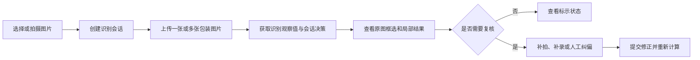

# WebClient · 轻眸识刻 Web 客户端

> 面向消费者、商超和仓储场景的通用 Web 基础客户端

WebClient 定义跨客户端共享的在线识别、结果查看、证据展示和人工纠偏基础能力，通过统一 HTTP API 对接 `TrainPlatform`，不直接访问数据库或模型文件。MobileClient 覆盖本客户端的全部在线能力，并针对移动设备增加拍摄辅助、弱网任务、本地记录和端云协同能力。

---

## 一、产品定位与客户端关系

主要场景：

- 消费者购买前查看包装日期；
- 家庭整理食品时核对期限；
- 商超、仓储和巡检人员辅助巡检。

WebClient 是不依赖特定移动操作系统的通用基础客户端。它与其他客户端的关系如下：

| 客户端 | 定位 | 主要特点 |
| :--- | :--- | :--- |
| **MobileClient** | 功能完整的移动端主客户端 | 覆盖 WebClient 的在线能力，并增加移动设备专属能力 |
| **WebClient** | 通用 Web 基础客户端 | 提供跨设备访问的识别、证据查看和人工纠偏能力 |
| **WxClient** | 微信生态免安装替代入口 | 面向临时查验和结果分享，不追求覆盖全部能力 |

项目重点处理日期区域过小、点阵喷码断笔、曲面反光和背景文字干扰等问题。

系统输出的是食品包装上的**标示状态**，不替代食品安全检测，也不直接判断食品是否绝对安全或适宜食用。

---

## 二、用户流程



---

## 三、功能分级

### 1. C0 核心闭环

- 单张或多张图片上传及识别会话管理；
- 展示日期区域检测框、置信度和 OCR 转录结果；
- 展示生产日期、到期日、保质期、标示状态及复核提示；
- 支持人工修正识别文本或检测框；
- 将机器观察值和人工修正值提交至后台。

补录字段和纠偏类型必须以正式 API 契约为准，未定义的扩展能力不得伪装成已支持的接口。

### 2. C1 交互增强

- 摄像头、拖拽、剪贴板和移动端相册导入；
- 同一食品的多图时间线；
- 原图框选与局部裁剪结果对照；
- 保质期等辅助信息补录和缺失证据补拍提示。

### 3. C2/C3 探索能力

以下能力属于可选增强或远期探索，不构成 C0 核心闭环的前置依赖：

- 浏览器端条码辅助解析；
- 移动端取景引导和弱网缓存；
- WebAssembly 条码或轻量模型运行时；
- 端侧与云端结果协同展示。

条码只作为弱辅助证据，不覆盖包装文字识别结果。相关浏览器能力不可用时，不应阻断图片上传主流程。

---

## 四、结果呈现

### 1. 图像视图

- 展示上传原图、日期区域检测框、类别和置信度；
- 支持多张图片切换；
- 局部视图明确区分原始裁剪图、几何校正图、局部增强图和 OCR 输入图。

### 2. 标示状态卡片

期限状态使用文字和图标共同表达：

- 标示在期内；
- 标示临期；
- 标示已超期；
- 暂无法判定。

复核状态包括证据完备、信息缺失、证据冲突和低置信度。冷藏、冷冻、避光或开封后时效等包装说明作为条件提示，不替代核心日期证据。

---

## 五、会话状态与错误处理

前端至少需要区分：

```text
IDLE
CREATING_SESSION
UPLOADING
PROCESSING
PARTIAL_RESULT
COMPLETED
NEEDS_REVIEW
FAILED
```

需要明确反馈的异常包括：

- 图片格式、大小或质量不符合要求；
- 会话失效、网络中断或推理超时；
- 识别结果不完整或证据冲突。

摄像头权限被拒绝时回退到文件上传；剪贴板或条码能力不可用时跳过对应步骤，不阻断主流程。

---

## 六、人工纠偏

人工纠偏应保留机器结果与修正结果的对应关系，例如：

```json
{
  "image_id": "img_001",
  "corrected_field": "mfg_date",
  "corrected_value": "2024-05-18",
  "correction_reason": "点阵字符识别错误"
}
```

提交纠偏后以服务端返回的最新会话决策为准，失败时不得显示成功状态。

---

## 七、跨仓接口契约

本仓不直接读写数据库，所有业务流转通过 `TrainPlatform` 的统一 HTTP API 完成：

- 创建会话：`POST /api/v1/sessions`
- 上传图片并执行增量识别：`POST /api/v1/sessions/{session_id}/images`
- 获取会话和完整证据：`GET /api/v1/sessions/{session_id}`
- 提交人工纠偏：`POST /api/v1/sessions/{session_id}/correction`

接口字段、响应结构、错误码和状态枚举以 [`ProjectPRD/contracts/API.md`](https://github.com/QingMouFoodDate/ProjectPRD/blob/main/contracts/API.md) 为准。辅助补录需在契约正式定义后接入。

---

## 八、工程结构

```text
WebClient/
├── README.md                      # 项目说明与开发约定
├── package.json                   # 前端依赖与工程脚本
├── vite.config.ts                 # 构建与开发代理配置
├── tsconfig.json                  # TypeScript 配置
├── index.html                     # 应用入口模板
└── src/
    ├── api/                       # HTTP 请求、响应和错误处理
    ├── components/                # 通用界面组件
    ├── features/                  # 会话、上传、结果和纠偏功能
    ├── services/                  # 摄像头、剪贴板和条码能力
    ├── stores/                    # 会话状态管理
    ├── types/                     # TypeScript 类型定义
    └── assets/                    # 静态资源
```

---

## 九、技术选型

技术路线可根据团队能力、生态、部署环境和跨端需求选择，不要求同时采用多套方案。

### 路线 A：React + TypeScript + Vite

- *优势*：适合复杂的多图会话、画布标注和状态管理，可搭配 React Router、TanStack Query、Zustand、Redux Toolkit 或主流 UI 组件库。

### 路线 B：Vue 3 + TypeScript + Vite

- *优势*：适合快速构建交互原型，可搭配 Vue Router、Pinia、VueUse 和 Element Plus。

### 路线 C：Java Spring Boot + 前端框架

- *优势*：Java 负责 BFF 或服务层，前端使用 React、Vue 或 Angular；适合已有 Java 后端、统一认证和企业部署体系的团队，复杂图片标注交互仍由现代前端负责。

### 路线 D：Next.js 或 Nuxt

- *优势*：适合需要服务端渲染、静态生成、服务端代理或前后端同仓协作的项目；Next.js 基于 React，Nuxt 基于 Vue，单机原型可优先选择 Vite。

无论选择哪条路线，前端都应遵守统一 API、数据模型、错误处理和状态枚举，不在客户端重复实现日期决策规则。

---

## 十、可访问性与隐私要求

- 结果不能只依赖颜色表达，应同时提供文字和图标；
- 关键结果支持大字号、高对比度和清晰说明；
- 上传、重试、补拍和纠偏按钮应具备明确标签和足够点击区域；
- 客户端不保存不必要的食品图片和识别结果；
- 前端日志不得记录原始图片、完整识别文本或其他不必要的敏感信息。

---

## 十一、相关文档

- [系统需求](https://github.com/QingMouFoodDate/ProjectPRD/blob/main/REQUIREMENTS.md)
- [系统架构](https://github.com/QingMouFoodDate/ProjectPRD/blob/main/ARCHITECTURE.md)
- [API 接口契约](https://github.com/QingMouFoodDate/ProjectPRD/blob/main/contracts/API.md)
- [数据模型](https://github.com/QingMouFoodDate/ProjectPRD/blob/main/contracts/DATA.md)
- [数据质量规范](https://github.com/QingMouFoodDate/ProjectPRD/blob/main/standards/DATA_QUALITY.md)
