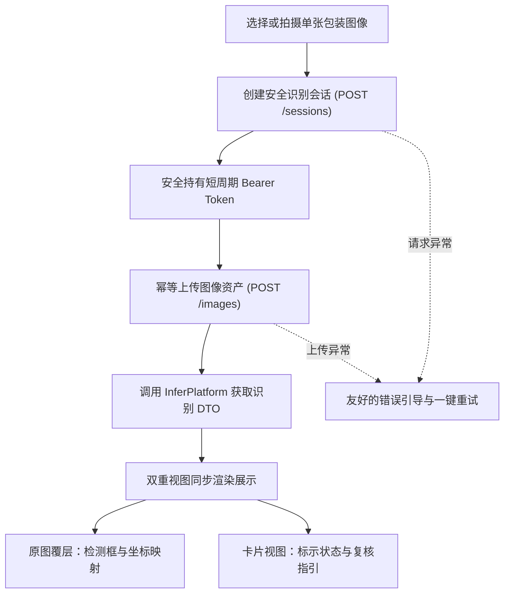

# WebClient · 轻眸识刻 Web 客户端

> 大创核心交付物与原型系统，验证单图会话、原图覆层与字段卡片双重视图交互
>
> **工程状态**：交互原型设计就绪 · M0 单图主链路验证中 · 统一接入 InferPlatform 业务网关

WebClient 是轻眸识刻系统的核心桌面与大屏 Web 交付系统，承担大创项目关键技术成果的完整可视化验证任务。系统面向消费者日常查验、商超理货与仓储巡检场景，通过调用 InferPlatform 提供的统一在线 API，完成高精度的单图识别验证、原图覆层可视化定位与结构化结果呈现。

---

## 工程状态与边界说明

- **当前阶段**：系统处于架构规范与 M0 核心原型攻坚阶段，优先验证单图查验全闭环主链路；
- **实现范围**：M0 阶段聚焦单张图像选择、上传编排与双重视图呈现；多图时间线比对、字段补录与人工纠偏作为后续 C0 目标递进展开；
- **契约基准**：界面数据渲染与接口通信严格受限于上位 [API.md](../ProjectPRD/contracts/API.md)、[DATA.md](../ProjectPRD/contracts/DATA.md) 与 [openapi.json](../ProjectPRD/contracts/openapi.json)。

---

## 一、核心定位与交付特色

### 1. 核心负责内容

- **单图主链路闭环**：实现创建安全会话、上传单张食品包装图像并轮询/获取完整识别结果的 M0 验证链路；
- **双重视图呈现架构**：
  - **原图覆层视图**：在原始分辨率图像上精准绘制日期目标检测边界框、预测类别与模型置信度覆层；
  - **结构化卡片视图**：独立呈现生产日期、保质期限、到期日与储存要求，结合二维状态明确标识标示结论；
- **健壮性交互反馈**：实现请求状态实时感知，对网络波动、低置信度、关键信息缺失提供明确的人机复核提示。

### 2. 系统协作与设计约束

- **算法轻量解耦**：浏览器端不承担重型深度学习运算或本地 OCR 模型，视觉前向计算完全托管至服务端 Inference Runtime；
- **业务规则中立**：客户端不自行编写本地日期加减或临期天数判定逻辑，所有业务状态（Decision）直接消费服务端的标准推导；
- **法定标示受限**：系统输出法定限定为“食品包装标示状态”，界面严禁向用户直接断言食品绝对可食用等卫生健康结论。

---

## 二、M0 交互主流程架构



---

## 三、双维度业务状态呈现

前端采用与服务端严格对齐的双维度状态映射体系，通过图标、文字与辅助色彩多重表达，杜绝仅依赖单一色彩传递信息：

| 维度 | 业务状态与枚举 | 界面展示与交互指引 |
| :--- | :--- | :--- |
| **包装标示状态** | `WITHIN_MARKED_PERIOD` 在期 | 绿色标识，清晰呈现标示有效期与计算基准 |
| | `NEAR_EXPIRY` 临期 | 橙色预警，突出展示剩余期限并提示优先食用/处理 |
| | `PAST_MARKED_PERIOD` 超期 | 红色警示，明确标示已超过包装标明日期 |
| | `UNDETERMINED` 无法判定 | 灰色中性，说明因信息缺失或冲突导致无法推导 |
| **证据复核状态** | `EVIDENCE_COMPLETE` 证据完备 | 证据链清晰，直接信赖推导结论 |
| | `INFORMATION_MISSING` 信息缺失 | 明确提示未识别到生产日期或保质期，引导针对性补拍 |
| | `EVIDENCE_CONFLICT` 证据冲突 | 提示推导到期日与包装直印到期日不一致，交由人工核验 |
| | `LOW_CONFIDENCE` 低置信度 | 提示打码模糊或反光严重，建议重新对焦拍摄 |

---

## 四、上位接口契约映射

客户端通信严格遵循上位 OpenAPI 3.1 标准定义的接口规范：

| 阶段 | HTTP 方法与路径 | 功能职责与交互行为 |
| :--- | :--- | :--- |
| **M0** | `POST /api/v1/sessions` | 初始化识别会话，获取 `session_id` 与短期透明凭据 `session_token` |
| **M0** | `POST /api/v1/sessions/{session_id}/images` | 携带 `Idempotency-Key` 幂等上传图像资产，触发服务端流水线编排 |
| **M0** | `GET /api/v1/sessions/{session_id}` | 获取会话最新结果，包含版本化 Observation、Evidence 与 Decision DTO |
| **C0** | `POST /api/v1/sessions/{session_id}/correction` | 提交字段级人工修正（限日期、保质期及储存条件四类字段） |

---

## 五、提议工程目录结构

以下为 Web 客户端工程的建议目录结构，遵循现代模块化前端开发范式：

```text
WebClient/                         # Web 客户端主仓库
├── README.md                      # 客户端定位与契约指引
├── package.json                   # 前端工程配置与依赖声明
├── vite.config.ts                 # 本地构建与代理开发配置
└── src/                           # 前端交互与视图组件源码
    ├── api/                       # 后端 API 接口与鉴权封装
    ├── components/                # 通用基础与视图呈现组件
    ├── features/                  # 业务功能与会话交互模块
    ├── services/                  # 设备能力与交互适配服务
    ├── stores/                    # 全局响应式状态管理模块
    ├── types/                     # 跨仓数据结构类型定义
    └── assets/                    # 静态设计图标与样式资源
```

---

## 六、权威依据与参考文档

- **系统设计与规划**：[ProjectPRD/REQUIREMENTS.md](../ProjectPRD/REQUIREMENTS.md) · [ProjectPRD/ARCHITECTURE.md](../ProjectPRD/ARCHITECTURE.md) · [ProjectPRD/ROADMAP.md](../ProjectPRD/ROADMAP.md)
- **跨仓技术契约**：[contracts/API.md](../ProjectPRD/contracts/API.md) · [contracts/DATA.md](../ProjectPRD/contracts/DATA.md) · [contracts/openapi.json](../ProjectPRD/contracts/openapi.json)
- **规则与决策记录**：[contracts/DATE_RULES.md](../ProjectPRD/contracts/DATE_RULES.md) · [decisions/ADR-001-REPOSITORY_BOUNDARIES.md](../ProjectPRD/decisions/ADR-001-REPOSITORY_BOUNDARIES.md)
- **工程与质量规范**：[standards/ENGINEERING.md](../ProjectPRD/standards/ENGINEERING.md)
