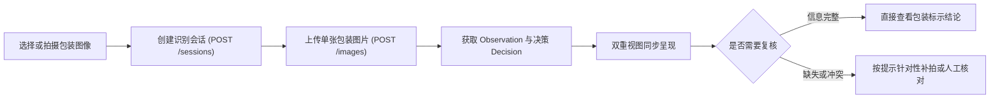

# WebClient · 轻眸识刻 Web 客户端

> 面向消费者、商超和仓储场景的通用 Web 基础客户端与核心原型系统
>
> **工程状态**：交互原型设计就绪 · M0 单图主链路验证中 · 统一接入 InferPlatform 业务网关

WebClient 定义轻眸识刻全域跨端共享的在线识别、结果查看、证据展示和人工纠偏基础能力，作为大创项目核心验收成果与第一阶段优先验证入口。系统通过统一 RESTful API 对接 InferPlatform 在线中枢，不直接访问底层数据库或模型文件。MobileClient 规划在此基础上增强现场移动能力，WxClient 则作为微信生态轻量免安装通道。

---

## 工程状态与阶段说明

WebClient 是 M0 单图闭环的第一阶段优先客户端方向。本仓库当前主要维护面向 Web 原型的产品设计、交互流程与跨仓契约约束，优先拉通单张图片从上传到双重视图呈现的端到端闭环验证；同一食品多图追加比对与人工纠偏作为后续 C0 目标递进展开。

---

## 一、产品定位与客户端关系

系统规划面向以下核心使用场景：

- **日常消费查验**：消费者购买食品前快速对准包装查看保质期与到期日；
- **家庭健康管理**：家庭整理食品储藏时批量核对在期状态与临期提示；
- **商超仓储巡检**：商超理货与仓储巡检人员辅助筛查临期或过期商品。

WebClient 作为跨操作系统与桌面大屏的通用基础端，与其他两端的分工协同如下：

| 客户端名称 | 架构定位 | 主要特点与协同分工 |
| :--- | :--- | :--- |
| **WebClient** | 通用 Web 基础客户端 | 跨设备访问的大屏桌面基准入口，提供原图覆层与字段卡片双重视图呈现 |
| **MobileClient** | 移动端扩展方向 | 规划覆盖 WebClient 在线能力，并增加现场手持稳态检测与离线台账 |
| **WxClient** | 微信生态免安装入口 | 面向临时轻量查验与长辈大字模式，不追求覆盖全部重型交互能力 |

项目重点解决包装日期微小、点阵喷码断笔、曲面反光与复杂背景干扰等现实难题。系统输出法定界定为食品包装上的**标示状态**，不替代食品安全检测，不直接判断食品是否绝对可食用。

---

## 二、用户交互主流程



---

## 三、功能分级与能力演进

### 1. M0 单图核心闭环

- **会话与上传**：支持选择单张图片、获取临时凭据并完成幂等上传；
- **原图画布覆层**：在原始分辨率图像上绘制小目标日期检测边界框，动态映射标签与置信度；
- **双维度结果卡片**：展示服务端计算的生产日期、保质期、到期日，并呈现标示状态与复核状态。

### 2. C0 多图扩展

- **多图流转时间线**：支持同一件食品的正面、背面、顶底多图追加；
- **跨图一致性比对**：展示不同图片提取的证据冲突（如印制到期日与计算到期日不一致）；
- **字段级人工纠偏**：通过 `correction.v1` 提交生产日期、保质期（数值 + 单位）或储存条件的人工修正并即时刷新决策。

### 3. C1 至 C3 探索能力

- **交互辅助增强**：拖拽上传、剪贴板粘贴与局部缩放图像对照；
- **条码弱辅助**：条码扫码辅助查询通用保质期信息，仅作为弱证据，不覆盖包装印刷实测字符。

---

## 四、双重视图结果呈现

前端采用与服务端严格对齐的展现架构，同时提供原图视觉空间与结构化卡片两大呈现维度：

1. **原图覆层视图**：按比例精确贴合模型输出的检测框，缩放时保持坐标映射稳定，展示置信度标签；
2. **结构化卡片视图**：独立呈现双维度状态枚举，绝不只依赖颜色传递信息：
   - **包装标示状态**：在期（`WITHIN_MARKED_PERIOD`）、临期（`NEAR_EXPIRY`）、超期（`PAST_MARKED_PERIOD`）、无法判定（`UNDETERMINED`）；
   - **证据复核状态**：证据完备（`EVIDENCE_COMPLETE`）、信息缺失（`INFORMATION_MISSING`）、证据冲突（`EVIDENCE_CONFLICT`）、低置信度（`LOW_CONFIDENCE`）。

---

## 五、会话状态与错误处理

前端 UX 维护明确的状态机转换流，服务调用异常时提供清晰的下一步指引：

```text
IDLE -> CREATING_SESSION -> UPLOADING -> PROCESSING -> RESULT_READY
请求失败 -> FAILED (展示明确错误原因与一键重试入口)
```

- 超时或推理失败明确提示服务暂不可用，严禁将基础设施失败伪装为“无法判定”；
- 会话鉴权凭据（`session_token`）仅在内存与会话生命周期中安全持有，不写入日志，不作为 URL 明文分享。

---

## 六、跨仓接口契约映射

客户端通信严格遵循上位 OpenAPI 3.1 标准定义：

| 阶段 | HTTP 方法与路径 | 功能职责与交互行为 |
| :--- | :--- | :--- |
| **M0** | `POST /api/v1/sessions` | 初始化识别会话，获取短期透明凭据 `session_token` |
| **M0** | `POST /api/v1/sessions/{session_id}/images` | 携带 `Idempotency-Key` 上传单张图片并获取处理结果 |
| **M0** | `GET /api/v1/sessions/{session_id}` | 获取完整版本化 Observation、Evidence 与 Decision DTO |
| **C0** | `POST /api/v1/sessions/{session_id}/correction` | 提交字段级人工修正（限日期、保质期及储存条件四类字段） |

---

## 七、提议工程目录结构

以下为 Web 客户端工程的建议目录结构，遵循现代模块化前端开发范式：

```text
WebClient/                         # Web 客户端主仓库
├── README.md                      # 客户端定位与契约指引
├── package.json                   # 前端工程配置与依赖声明
├── vite.config.ts                 # 本地构建与代理开发配置
└── src/                           # 前端交互与视图组件源码
    ├── api/                       # 后端 API 接口与鉴权封装
    ├── components/                # 通用基础与视图呈现组件
    ├── features/                  # 业务功能与会话交互模块
    ├── services/                  # 设备能力与交互适配服务
    ├── stores/                    # 全局响应式状态管理模块
    ├── types/                     # 跨仓数据结构类型定义
    └── assets/                    # 静态设计图标与样式资源
```

---

## 八、权威依据与参考文档

- **系统设计与规划**：[ProjectPRD/REQUIREMENTS.md](../ProjectPRD/REQUIREMENTS.md) · [ProjectPRD/ARCHITECTURE.md](../ProjectPRD/ARCHITECTURE.md) · [ProjectPRD/ROADMAP.md](../ProjectPRD/ROADMAP.md)
- **跨仓技术契约**：[contracts/API.md](../ProjectPRD/contracts/API.md) · [contracts/DATA.md](../ProjectPRD/contracts/DATA.md) · [contracts/openapi.json](../ProjectPRD/contracts/openapi.json)
- **规则与决策记录**：[contracts/DATE_RULES.md](../ProjectPRD/contracts/DATE_RULES.md) · [decisions/ADR-001-REPOSITORY_BOUNDARIES.md](../ProjectPRD/decisions/ADR-001-REPOSITORY_BOUNDARIES.md)
- **工程与质量规范**：[standards/ENGINEERING.md](../ProjectPRD/standards/ENGINEERING.md)
