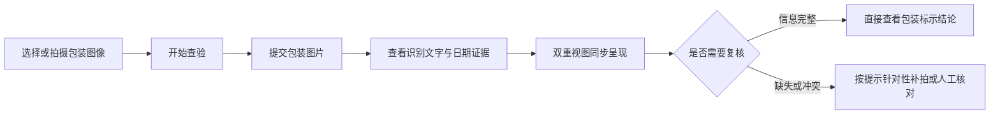
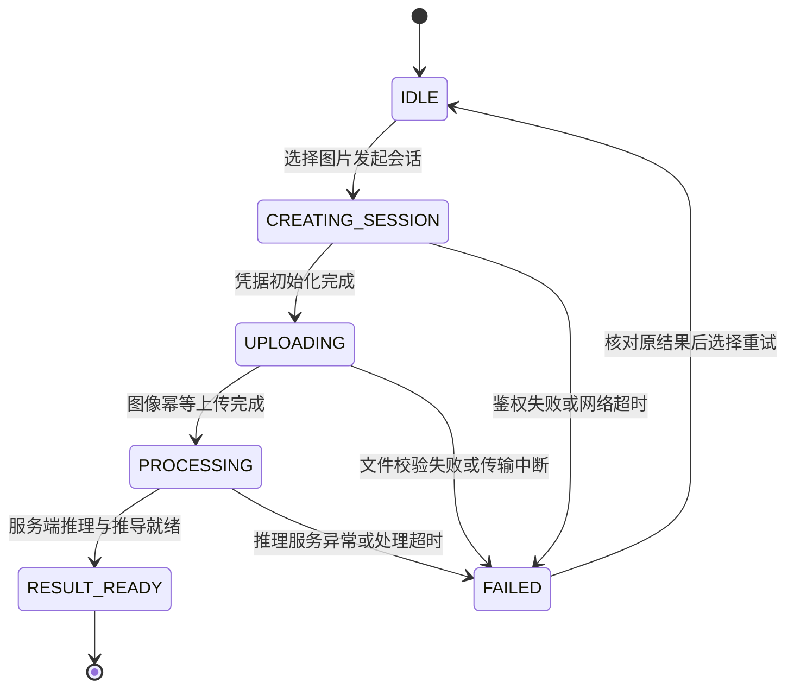

# WebClient · 轻眸识刻 Web 客户端

> 面向消费者、商超和仓储场景的通用 Web 基础客户端与核心原型系统
>
> **工程状态**：M0 单图主链路待实现 · Web 优先实施

WebClient 定义跨端共享的在线识别、结果查看、证据展示与人工纠偏基础能力，作为大创项目核心验收成果与优先验证入口。通过 RESTful API 对接 InferPlatform 在线中枢，不直连底层数据库或模型文件。MobileClient 规划增强现场移动能力，WxClient 作为微信生态轻量通道。

---

## 工程状态与阶段说明

WebClient 是 M0 优先实现的客户端，当前主要维护产品设计、交互流程与接口约定。首轮验证单图上传、识别和双重视图展示；多图比对与人工纠偏在后续 C0 阶段推进。MobileClient 与 WxClient 暂缓实现，不作为 M0 的前置依赖。

---

## 一、产品定位与客户端关系

系统规划面向以下核心使用场景：

- **日常消费查验**：消费者购前对准包装核验保质期与到期日；
- **家庭健康管理**：整理食品储藏时核对在期状态与临期提示；
- **商超仓储巡检**：商超理货与仓储巡检辅助筛查临期或过期商品。

WebClient 作为通用基础端，与其他两端的分工协同如下：

| 客户端名称 | 架构定位 | 主要特点与协同分工 |
| :--- | :--- | :--- |
| **WebClient** | 通用 Web 基础客户端 | 桌面大屏基准入口，提供原图覆层与字段卡片双重视图呈现 |
| **MobileClient** | 移动端扩展方向 | 规划覆盖 WebClient 在线能力，增加现场手持稳态检测与离线台账 |
| **WxClient** | 微信生态免安装入口 | 面向临时轻量查验与长辈大字模式，不追求覆盖全部重型交互 |

系统输出限定为食品包装上的**标示状态**，不替代食品安全检测，不直接判断食品是否绝对可食用。

---

## 二、用户交互主流程



M0 每个会话只接收一张图片，补拍新图需新建会话；C0 再支持向原会话追加图片。

---

## 三、功能分级与能力演进

### 1. M0 单图核心闭环

- **会话与上传**：支持选择单张包装图片，提交后查看处理进度；
- **原图画布覆层**：在原图上绘制日期检测边界框，展示标签、OCR 原文与检测/OCR 各自置信度；
- **双维度结果卡片**：展示生产日期、保质期、到期日及证据来源，并独立呈现标示状态与复核状态。

### 2. C0 多图扩展

- **多图流转时间线**：支持同一食品的正面、背面、顶底多图追加；
- **跨图一致性比对**：展示不同图片提取的证据冲突；
- **字段级人工纠偏**：通过 `correction.v1` 提交生产日期、到期日、保质期或储存条件修正并即时刷新决策。

完整 C0 的 OCR 原文/bbox 修正及图像变体展示尚未定义在线契约，需评审后接入。

### 3. C1 至 C3 探索能力

- **交互辅助增强**：拖拽上传、剪贴板粘贴与局部缩放对照；
- **条码弱辅助**：条码提供商品关联线索，不用通用保质期或数据库推测值代替当前包装上的标示信息。

---

## 四、双重视图结果呈现

前端提供原图视觉空间与结构化卡片两大呈现维度：

| 呈现维度 | 视图形式 | 核心展示内容与枚举项 |
| :--- | :--- | :--- |
| **空间坐标维度** | 原图覆层视图 | 按比例贴合检测边界框，缩放时保持坐标映射稳定，展示标签、OCR 原文及检测/OCR 各自置信度 |
| **包装标示状态** | 结构化卡片视图 | 结合日期字段与证据来源展示在期（`WITHIN_MARKED_PERIOD`）、临期（`NEAR_EXPIRY`）、超期（`PAST_MARKED_PERIOD`）、无法判定（`UNDETERMINED`） |
| **证据复核状态** | 独立指引卡片 | 证据完备（`EVIDENCE_COMPLETE`）、信息缺失（`INFORMATION_MISSING`）、证据冲突（`EVIDENCE_CONFLICT`）、低置信度（`LOW_CONFIDENCE`） |

期限状态与复核状态独立展示；信息缺失不等于超期。

---

## 五、会话状态与错误处理

下图为客户端本地交互状态，服务端会话状态以数据契约为准：




- 上传或处理超时先查询已有会话结果，创建请求超时则复用原键获取原结果；技术失败单独提示，不作为“无法判定”的业务结论；
- 会话凭据（`session_token`）在会话生命周期中安全持有，不写入日志，不作 URL 明文分享。

---

## 六、跨仓接口契约映射

客户端通信遵循 OpenAPI 3.1 标准定义：

| 阶段 | HTTP 方法与路径 | 功能职责与交互行为 |
| :--- | :--- | :--- |
| **M0** | `POST /api/v1/sessions` | 初始化识别会话，获取短期不透明凭据 `session_token` |
| **M0** | `POST /api/v1/sessions/{session_id}/images` | 携带 `Idempotency-Key` 上传单张图片并获取处理结果 |
| **M0** | `GET /api/v1/sessions/{session_id}` | 获取完整版本化 Observation、Evidence 与 Decision DTO |
| **C0** | `POST /api/v1/sessions/{session_id}/correction` | 提交字段级人工修正（`mfg_date`、`exp_date`、`shelf_life`、`storage_condition`） |

创建、上传和纠偏均携带 `Idempotency-Key`，同一请求重试复用原键和原内容，换图或改值使用新键。后续查询、上传和纠偏使用短期不透明 `session_token` 作为 Bearer 凭据，并校验会话与图片归属。GET 返回完整结果，不返回令牌；凭据遗失时需新建会话。

---

## 七、提议工程目录结构

```text
WebClient/                         # Web 客户端主仓库
├── README.md                      # 客户端定位与契约指引
├── package.json                   # 前端工程配置与依赖声明
├── vite.config.ts                 # 本地构建与代理开发配置
└── src/                           # 前端交互与视图组件源码
    ├── api/                       # 后端 API 接口与鉴权封装
    ├── components/                # 通用基础与视图呈现组件
    ├── features/                  # 业务功能与会话交互模块
    ├── services/                  # 设备能力与交互适配服务
    ├── stores/                    # 全局响应式状态管理模块
    ├── types/                     # 跨仓数据结构类型定义
    └── assets/                    # 静态设计图标与样式资源
```

---

## 八、相关文档

- [需求规格](https://github.com/QingMouFoodDate/ProjectPRD/blob/main/需求规格.md)
- [系统架构](https://github.com/QingMouFoodDate/ProjectPRD/blob/main/系统架构.md)
- [开发路线](https://github.com/QingMouFoodDate/ProjectPRD/blob/main/开发路线.md)
- [API 接口契约](https://github.com/QingMouFoodDate/ProjectPRD/blob/main/contracts/API.md)
- [数据模型](https://github.com/QingMouFoodDate/ProjectPRD/blob/main/contracts/DATA.md)
- [日期推导规则](https://github.com/QingMouFoodDate/ProjectPRD/blob/main/contracts/日期推导规则.md)
- [工程协作指南](https://github.com/QingMouFoodDate/ProjectPRD/blob/main/standards/工程协作指南.md)
- [数据质量规范](https://github.com/QingMouFoodDate/ProjectPRD/blob/main/standards/数据质量规范.md)


