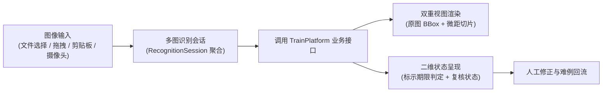

# WebClient · 轻眸识刻 Web 客户端

> **组织归属**：`QingMouFoodDate` GitHub 组织  
> **仓库性质**：大创立项申报书核心预期成果（成果 3：食品包装日期识别 Web 原型系统），面向跨平台用户与评测人员的交互前台

---

## 一、 核心定位与业务价值

在大创立项申报书第四部分“预期成果”中，明确将“开发食品包装日期识别 Web 原型系统，实现图像上传、日期识别、结果展示、人工修正和样本回流等功能”列为核心交付成果。

本仓库即为该项承诺的落地载体，是整个系统中最先实现、功能完备的主力交互前台，支持桌面与移动浏览器访问：



---

## 二、 功能要求与呈现形态

### 1. 多模式图像输入
- **设备摄像头实时捕获**：基于 WebRTC 标准接口调起设备可用摄像头实时抓拍，若浏览器硬件环境受限，自动平滑回退至系统原生相机捕获通道；
- **多渠道文件导入**：支持本地多图片选择、页面全局拖拽放置，以及通过剪贴板直接粘贴屏幕截图。

### 2. 条形码辅助解析
- 前端内置条形码识别算子，优先调用浏览器原生条码识别接口，在不支持的环境下通过 WebAssembly 解码模块平滑回退，自动抽取食品包装上的 EAN-13 商品条码，作为辅助信息同步提交至会话。

### 3. 多图识别会话面板
- 支持针对同一件食品连续上传多张不同部位特写（如瓶盖打码、包装背面配料表、侧面条码）；
- 界面以时间线形式展示会话累积的证据片段，并在信息不全时靶向提示“缺少保质期时长，请补拍包装背标”。

### 4. 双重视图与结果呈现形态
- **全景标注画布**：原图自适应缩放展示，动态绘制检测出的打码区域矩形框与置信度标签；
- **局部微距对比视窗**：浮窗放大展示经几何拉平与自适应增强后的打码特写切片；
- **二维状态卡片**：
  - 期限判定状态：标示在期内、标示临期、标示已超期、暂无法判定；
  - 复核状态：证据完备、信息缺失、证据冲突、低置信度；
  - 条件预警提示：展示冷藏、冷冻、避光或开封后时效等包装说明。

### 5. 人工确认与纠偏回流
- **保质期辅助补录抽屉**：当画面仅识别出生产日期而缺少保质期时，展开补录抽屉提供常见品类常规天数参考，经用户确认后提交系统计算；
- **校正回流通道**：用户可在线修改识别错误的日期或打码框位置，一键提交至后台难例库。

---

## 三、 推荐前端工程架构

目录结构遵循组件化解耦标准，除根目录核心配置文件外，子目录仅展示文件夹层级：

```text
WebClient/
├── README.md
├── package.json
├── vite.config.ts
├── tsconfig.json
├── index.html
└── src/
    ├── api/
    ├── types/
    ├── components/
    ├── services/
    ├── hooks/
    └── assets/
```

---

## 四、 跨仓接口契约

本仓不直接读写数据库，所有业务流转通过标准 HTTP API 接入 TrainPlatform：
- **会话生命周期与图片上传**：对接 `POST /api/v1/sessions` 及 `POST /api/v1/sessions/{id}/images`；
- **辅助信息补充**：对接 `POST /api/v1/sessions/{id}/evidence`；
- **人工纠错反馈**：对接 `POST /api/v1/sessions/{id}/correction`。

---

## 五、 技术选型参考

- **路线 A（推荐 · 现代化大型工程化）**：`React + TypeScript + Vite + TailwindCSS`
  - *推荐理由*：生态组件库丰富，状态机控制严密，便于构建包含多图时间线与画布标注的复合型前台。
- **路线 B（备选 · 轻量高效）**：`Vue 3 + TypeScript + Vite + Element Plus`
  - *适用场景*：响应式数据绑定直观，上手门槛低，适合快速迭代页面组件。
