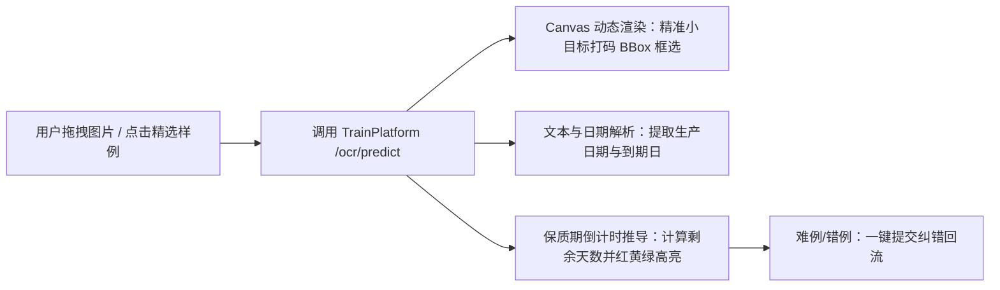

# WebClient · 轻眸识刻 Web 客户端

> **组织归属**：`QingMouFoodDate` GitHub 组织  
> **仓库性质**：面向桌面端与全平台的食品包装日期**在线识别、交互演示与答辩评测前台**  

---

## 💻 一、 核心定位与业务价值

本仓库是轻眸识刻面向**答辩评委、评审专家、测试人员与桌面端用户**的核心交互前台与演示大屏：



### 核心亮点设计
1. **多模式图片输入**：支持本地文件拖拽、点击上传、剪贴板截图直接粘贴；
2. **一键样例试用 (Sample Gallery · 答辩杀手锏)**：
   - 界面底部提供来自共享暂存库 `../data/raw/` 的 6~8 张典型包装样例（易拉罐底、饮料瓶盖、辣条包装、反光曲面）；
   - 评审老师或测试者无需翻找手机相册，直接点击样例卡片即可秒级触发识别与倒计时演示！
3. **可视化交互画布 (BBox Viewer)**：
   - 原图等比例高清渲染，动态绘制小目标检测框与识别置信度标签；
   - 悬浮局部放大镜效果，便于看清微小点阵喷码与无墨钢印；
4. **保质期推导看板 (Shelf Life Card)**：
   - 自动对比当前日期，直观呈现距离过期的倒计时天数；
   - 分类提示：安全 (NORMAL, 绿)、临期预警 (NEAR EXPIRY, 黄)、已过期 (EXPIRED, 红)；
5. **难例纠偏与回流标记**：
   - 当模型识别出现偏差时，评测人员可在线直接修改文本与日期，点击“提交纠错”自动调用 `/samples/feedback` 沉淀至难例微调池。

---

## 🏗️ 二、 推荐前端工程架构 (现代化前端标准)

为保证前端模块化与良好的扩展性，**推荐采用清晰的组件化架构**：

```text
WebClient/ (推荐目录结构参考)
├── README.md                      # 本说明文档
├── package.json                   # 前端依赖声明
├── vite.config.ts                 # Vite 构建配置（可配置开发跨域代理至 http://localhost:8000）
├── tsconfig.json                  # TypeScript 编译配置
├── index.html                     # HTML 入口
└── src/                           # 核心源码
    ├── api/                       # 【接口层】统一封装 Axios 请求，对接 TrainPlatform API
    │   └── ocr.ts                 # predict() 与 feedback() 方法
    ├── types/                     # 【类型定义】TypeScript 强类型 (与后端 JSON Schema 100% 对应)
    │   └── ocr.ts                 # BBox, PredictResponse, ShelfLifeStatus
    ├── components/                # 【UI 交互组件】
    │   ├── DragUploader.vue       # 拖拽/上传/粘贴图片输入组件
    │   ├── BBoxViewer.vue         # 核心交互画布：原图渲染与检测框绘制
    │   ├── ShelfLifeCard.vue      # 生产日期、到期日与红黄绿状态卡片
    │   └── SampleGallery.vue      # 底部一键体验样例栏
    ├── assets/                    # 静态资源与样式
    └── App.vue / App.tsx          # 演示大屏主界面布局
```

---

## 🤝 三、 跨仓接口契约

本仓不直接操作数据库，所有业务数据严格通过 HTTP API 与后端交互：
- **在线预测接口**：遵循 [`ProjectPRD/contracts/api_specs.md`](https://github.com/QingMouFoodDate/ProjectPRD/blob/main/contracts/api_specs.md) 中的 `POST /api/v1/ocr/predict`；
- **错例反馈接口**：遵循 `POST /api/v1/samples/feedback`。

---

## 🚀 四、 技术选型指南 (留给负责人的自主空间)

- **框架建议**：`Vue 3` 或 `React`，搭配现代构建工具 `Vite`；
- **样式推荐**：`TailwindCSS`（开发效率高，适合快速打磨高颜值大屏）或常用组件库（Element Plus / Ant Design / Shadcn-UI）；
- **前端负责同学拥有技术栈自主决断权**，核心是打造出**流畅的拖拽交互、惊艳的原图画框效果与直观的倒计时卡片**！

---

## 🏁 五、 阶段完成定义 (Definition of Done, DoD)

- [ ] **阶段 1 (静态交互原型)**：完成页面布局搭建，支持拖入图片并在页面上展示；
- [ ] **阶段 2 (对接 Mock API)**：请求后端 `/ocr/predict`，成功在 Canvas 上根据返回坐标画出 BBox 矩形框，并渲染日期与剩余天数卡片；
- [ ] **阶段 3 (答辩大屏就绪)**：接入内置样例试用栏与纠偏反馈，形成完整的交互演示闭环。
